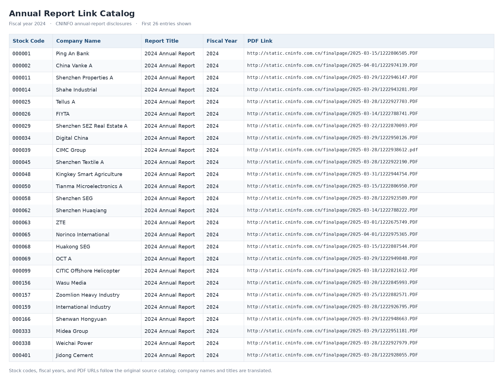

# Digital Technology Risk Exposure in Chinese Listed Firms: Text-Based Measurement Replication and Methodological Extensions

[中文 README](README_zh.md) · [Methods](docs/METHODS.md) · [Real-World Examples](docs/CASE_STUDIES.md) · [Paper–Code Comparison](docs/PAPER_VS_CODE.md)

First, a note about the journal: *Economic Research Journal* (《经济研究》) is not the SSCI-indexed English-language journal *China Economic Review*. It is a leading Chinese economics journal and is classified as A1 in Hunan University's journal ranking, alongside *The Economic Journal*, *The Review of Economics and Statistics* (sometimes called the “small RES”), and *Management Science*. In the same ranking, *China Economic Review* is classified as A3, together with *Energy Economics* and other well-regarded field journals, while JEEM and JBEO are classified as A2.

I started this project to replicate the text-based measurement approach in Lu, Shi, and Zhou (2025), “中国企业数字技术风险暴露对企业价值的影响——来自大语言模型的文本分析证据” (*Impact of Digital Technology Risk Exposure on Corporate Value in Chinese Firms: Evidence from Text Analysis Using Large Language Models*), published in *Economic Research Journal*, issue 2, pp. 73–89. My work focuses on collecting annual reports of Chinese listed firms, converting PDFs to text, extracting Management Discussion and Analysis (MD&A) sections, screening risk-related sentences, exploring dictionary expansion with Word2Vec, and experimenting with sentiment classification models.

## Project Scope

- With additional examples and adaptations, the workflow can support a broad range of text-based research on Chinese listed firms, including word-frequency analysis, large language models, and sentiment classification. The intended historical coverage is approximately **1999–2025**. For example, the 2024 annual-report link catalog contains **5,236 records**, covering around **5,000 listed firms**.
- Collect annual reports for the latest available year (as of October 2026, including reports from 2026 and earlier years). Starting from a catalog of report links, the workflow downloads PDFs and converts them to TXT files, with rate limiting and compliance considerations, while recording failed downloads and scanned documents.
- Extract MD&A sections using auditable, rule-based methods and produce an audit table for manual checks.
- Follow the keyword classification approach in Table 1 of the paper to extract candidate sentences from MD&A text.
- Use external Word2Vec vectors and related methods to suggest dictionary expansions, without treating semantically similar terms as an already validated dictionary.
- Provide a data format for model-assisted annotation, manual review, and resolving conflicting labels.
- When labeled data are available, train a user-specified Chinese Transformer model and generate probabilities for risk exposure and preventive measures.
- Construct overall digital technology risk, data security risk, and cybersecurity risk exposure indices using the main formula described in the paper, with explicit rules for missing components.

The original paper studies **2003–2022**. **The 2024 annual reports shown below are later data-processing examples**, not part of its original research sample. This repository focuses on the text measurement workflow rather than reproducing the full set of corporate-value regressions.

## Workflow

```text
Annual-report link catalog
          ↓
PDF collection → TXT conversion
          ↓
Management Discussion and Analysis (MD&A) extraction
          ↓
Risk keyword matching → Candidate sentences
          ↓
Annotation, manual review, and model prediction
          ↓
Firm-year digital technology risk exposure indices
```

## 2024 Annual-Report Examples

The screenshot below shows part of the annual-report link catalog I compiled, including stock codes, company names, report titles, fiscal years, and PDF download links. Eight records from the screenshot are provided in [`annual_report_catalog_2024_sample.csv`](examples/real_2024/annual_report_catalog_2024_sample.csv).



| Company | Original annual report | Source text excerpt | Extracted section excerpt |
|---|---|---|---|
| Ping An Bank (000001) | [2024 annual report](https://static.cninfo.com.cn/finalpage/2025-03-15/1222806505.PDF) | [TXT](examples/real_2024/report_excerpts/000001_source_report_excerpt.txt) | [TXT](examples/real_2024/report_excerpts/000001_extracted_section_excerpt.txt) |
| China Vanke A (000002) | [2024 annual report](https://static.cninfo.com.cn/finalpage/2025-04-01/1222974139.PDF) | [TXT](examples/real_2024/report_excerpts/000002_source_report_excerpt.txt) | [TXT](examples/real_2024/report_excerpts/000002_extracted_section_excerpt.txt) |
| Digital China (000034) | [2024 annual report](https://static.cninfo.com.cn/finalpage/2025-03-29/1222950126.PDF) | [TXT](examples/real_2024/report_excerpts/000034_source_report_excerpt.txt) | [TXT](examples/real_2024/report_excerpts/000034_extracted_section_excerpt.txt) |

An additional example for comparison is the [2024 annual report of Junhe Pumps (603617; PDF hosted on the company's website)](https://www.junhepumps.com/uploads/files/20250425/25a2c74842b20cb5c8ecc461b33be393.pdf). As a Shanghai Stock Exchange-listed firm, it provides another annual-report format for testing the extraction workflow.

## How to Run

Use **Python 3.10+** and run the following commands from the repository root:

```bash
python -m pip install -e .
python scripts/run_demo.py
python -m unittest discover -s tests -v
```

The offline demonstration uses fictional examples so that the code can run without additional databases or model weights. For step-by-step commands for processing actual annual reports, see the [methods documentation](docs/METHODS.md) and [scripts guide](scripts/README.md). Note also that **fiscal years and disclosure years are different**: by October 2026, full-year annual reports for fiscal year **2025** are generally available, whereas reports for fiscal year **2026** will typically begin to be released in **2027**.

## Repository Structure

```text
figures/                  Screenshot of the annual-report link catalog
examples/real_2024/       Actual report links, source excerpts, and extraction excerpts
src/digirisk/              Annual-report processing, text screening, index construction, and CLI code
notebooks/                Original notebooks and separate model experiments
scripts/                  Offline demonstration and optional Chinese-model training
data/lexicon/             Initial digital-risk keyword lists
data/example/             Fictional samples and reproducible test inputs
tests/                    Unit tests
docs/                     Methods, case studies, provenance, and citation notes
```

## Paper Citation and Code Provenance

**Original paper:** 陆瑶，施函青，周欣怡. 2025. 中国企业数字技术风险暴露对企业价值的影响——来自大语言模型的文本分析证据[J]. 经济研究，60(2): 73–89.

- [Economic Research Journal, 2025 Issue 2 (National Center for Philosophy and Social Sciences Documentation)](https://m.ncpssd.cn/journal/details?gch=95645X&langType=1&nav=1&num=2&years=2025)
- [References and data sources](docs/REFERENCES.md) · [Paper–code comparison](docs/PAPER_VS_CODE.md)

This project independently replicates and extends methods described in the published paper. The paper's findings belong to its original authors. Notebooks, tool-related ideas, and model experiments from different sources are credited separately in the relevant documentation; I do not present others' contributions as my own. Original annual reports and external models remain subject to their respective usage requirements.

**Yuankui Wang (王元奎)** · Hunan University
