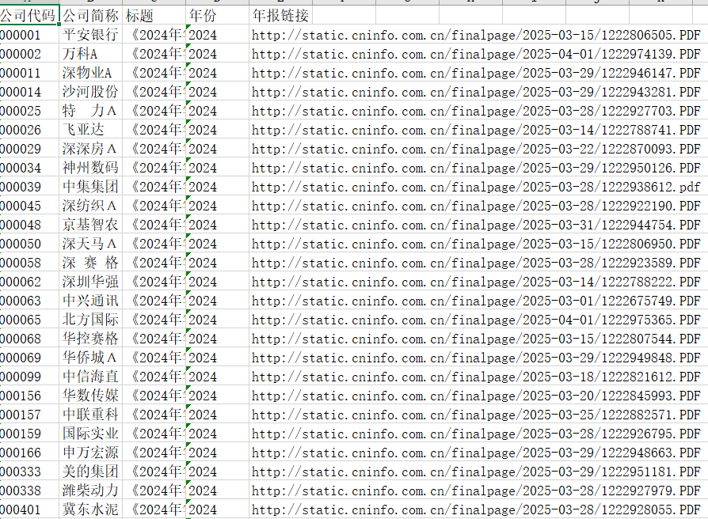

# 中国上市公司数字技术风险暴露：文本测度复现与方法扩展

[English README](README.md) · [方法说明](docs/METHODS.md) · [真实案例](docs/CASE_STUDIES_zh.md) · [论文与代码对应表](docs/PAPER_VS_CODE.md)

这个项目源于我对**陆瑶、施函青、周欣怡（2025）**发表于《经济研究》的论文《中国企业数字技术风险暴露对企业价值的影响——来自大语言模型的文本分析证据》的学习和复现。《经济研究》英文刊名为 *Economic Research Journal*，是中文经济学学术期刊，**不是**英文期刊 *China Economic Review*。

我主要做了上市公司年报链接整理、PDF转文本、管理层讨论与分析（MD&A）章节提取、风险相关文本筛选、Word2Vec词典扩展探索和情感分类模型实验。后来又把这套流程整理成了便于复用和检查的代码，并加入了**2024年上市公司年报的真实处理案例**。

## 项目内容

- **年报收集：** 按企业和年份整理年报链接，下载PDF并转换为TXT，对失败、缺失和扫描件情况进行记录。
- **MD&A提取：** 识别年报的管理层讨论与分析章节，保留可以与原文核对的提取结果。
- **风险文本筛选：** 参考原论文表1的数字技术风险分类及关键词思路，提取候选语句并保存来源位置。
- **标注与模型：** 为模型辅助标注、人工复核、中文Transformer训练和概率预测提供数据格式与代码；TextCNN、TextRNN、BERT的独立实验另行存档。
- **指数构造：** 在获得分类结果后，按企业—年份构造数字技术风险、数据风险和网络风险暴露指标。

原论文的研究样本为2003—2022年。**下面展示的2024年年报属于后续数据处理案例**，并非原论文样本。本仓库着重整理文本测度部分，不以完整重做企业价值回归为目标。

## 处理流程

```text
上市公司年报链接目录
       ↓
PDF收集 → TXT转码
       ↓
管理层讨论与分析（MD&A）提取
       ↓
风险关键词匹配 → 候选语句
       ↓
标注、人工复核与模型预测
       ↓
企业—年份数字技术风险指数
```

## 2024年年报处理案例

下面是我整理的部分年报链接截图，包含公司代码、简称、标题、报告年份及对应PDF下载链接。截图对应的8条记录已整理为 [`annual_report_catalog_2024_sample.csv`](examples/real_2024/annual_report_catalog_2024_sample.csv)。



| 公司 | 原始年报 | 原文片段 | 提取结果片段 |
|---|---|---|---|
| 平安银行（000001） | [2024年报](https://static.cninfo.com.cn/finalpage/2025-03-15/1222806505.PDF) | [TXT](examples/real_2024/report_excerpts/000001_source_report_excerpt.txt) | [TXT](examples/real_2024/report_excerpts/000001_extracted_section_excerpt.txt) |
| 万科A（000002） | [2024年报](https://static.cninfo.com.cn/finalpage/2025-04-01/1222974139.PDF) | [TXT](examples/real_2024/report_excerpts/000002_source_report_excerpt.txt) | [TXT](examples/real_2024/report_excerpts/000002_extracted_section_excerpt.txt) |
| 神州数码（000034） | [2024年报](https://static.cninfo.com.cn/finalpage/2025-03-29/1222950126.PDF) | [TXT](examples/real_2024/report_excerpts/000034_source_report_excerpt.txt) | [TXT](examples/real_2024/report_excerpts/000034_extracted_section_excerpt.txt) |

另提供一个原文对照案例：[君禾泵业（603617）2024年年度报告（公司官网PDF）](https://www.junhepumps.com/uploads/files/20250425/25a2c74842b20cb5c8ecc461b33be393.pdf)。它来自上交所上市公司，可以作为不同年报模板的补充样本。仓库中保留的是**少量原文与提取片段**，完整年报通过原始披露页面访问。

此外， [`keyword_screening_output_excerpt.csv`](examples/real_2024/keyword_screening_output_excerpt.csv) 收录了你提供的筛选结果表中的**19条候选文本**，来自平安银行和神州数码两家公司。它们是关键词命中记录，**不等于已完成风险暴露判定**。例如“黑客马拉松”也会命中“黑客”，但语境可能只是创新活动，这也是后续分类与人工复核的意义。案例说明见[这里](docs/CASE_STUDIES_zh.md)。

## 运行方式

使用 Python 3.10+，在仓库根目录执行：

```bash
python -m pip install -e .
python scripts/run_demo.py
python -m unittest discover -s tests -v
```

离线演示数据为虚构样例，目的是让程序在没有额外数据库和模型权重的情况下也能运行；真实年报处理的分阶段命令见[方法说明](docs/METHODS.md)和[脚本说明](scripts/README.md)。另外，报告年份与披露年份不一样：**2026年内通常可以收集完整的2025财年年报**，2026财年年报一般要等到2027年才陆续披露。

## 仓库结构

```text
figures/                  年报链接目录截图
examples/real_2024/       真实年报来源链接、原文与提取片段
src/digirisk/              年报处理、文本筛选、指数计算和命令行代码
notebooks/                原始Notebook与独立模型实验
scripts/                  离线演示和可选中文模型训练
data/lexicon/             数字风险初始关键词表
data/example/              虚构样本与可复现测试输入
tests/                     单元测试
docs/                      研究方法、案例、来源与引用说明
```

## 论文引用与代码来源

**原始论文：** 陆瑶，施函青，周欣怡. 2025. 中国企业数字技术风险暴露对企业价值的影响——来自大语言模型的文本分析证据[J]. 经济研究，60(2): 73–89.

- [《经济研究》2025年第2期目录（国家哲学社会科学文献中心）](https://m.ncpssd.cn/journal/details?gch=95645X&langType=1&nav=1&num=2&years=2025)
- [参考文献与数据来源](docs/REFERENCES.md) · [论文与代码对应表](docs/PAPER_VS_CODE.md)
- 
本项目依托原论文的方法和公开发表的研究内容开展独立复现与扩展。论文结论归原作者所有；不同来源的Notebook、工具思路和模型实验在相关文档中分别注明，不把其他人的贡献写成自己的工作。年报原始文件及外部模型遵循对应的使用要求。

**王元奎（Yuankui Wang）** · Hunan University
